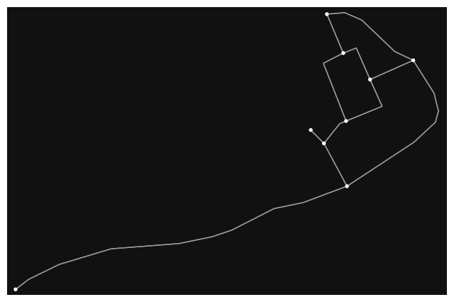
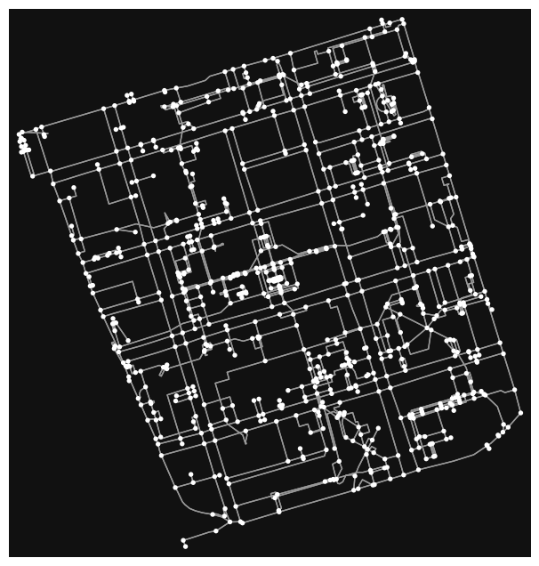

# 01 — Graphs, shortest-path algorithms, and a real data surprise

## The algorithm side: Dijkstra and A*

Once the road network is a graph (nodes = intersections, edges = segments, weights = real travel cost), finding the "best route" means finding the path through that graph with the lowest total weight.

**Dijkstra's algorithm** does this by expanding outward from the start node, always exploring the closest-so-far node next, and keeping track of the cheapest known cost to reach every node it has seen. It guarantees the shortest path, but it explores in every direction equally — it doesn't know where the destination actually is.

**A\*** is Dijkstra with a hint: for every node it's considering, it also estimates "how much further is this node from the destination, at minimum?" using straight-line (Haversine) distance as that estimate. Because straight-line distance can never be *longer* than the real route, this estimate is always optimistic (a true lower bound) — which is what keeps A* correct while still being faster, since it explores mostly in the direction of the goal instead of in every direction.

## Getting hands-on: downloading a real area with osmnx

I started small — downloaded Ken Sturgeon Park in Newmarket with `osmnx`:

```python
G = ox.graph_from_place("Ken Sturgeon Park, Newmarket, Canada", network_type="walk")
```

9 nodes, 22 edges. Plotted it with `ox.plot_graph(G)` and got a real shape matching the park's actual paths:



Each edge comes with real attributes osmnx computes automatically — `length` (Haversine distance, done for us), `highway` (road/path type), `oneway`, and sometimes `geometry` (the precise curved shape of the path, not just a straight line between its two endpoints).

## The real finding: accessibility tags looked completely missing

I checked every edge for `wheelchair` and `surface` tags — nothing, in the park or even in a much bigger, busier test area (Financial District, Toronto: 834 nodes, 2372 edges):



I also checked every node for `kerb`, `crossing`, `tactile_paving` — still nothing. That's a serious problem if the whole project depends on this data existing.

Before assuming the data just isn't there, I looked into *why* osmnx might be hiding it — and found the actual cause: **osmnx filters OSM tags through a whitelist before it ever builds the graph.** Its defaults (`ox.settings.useful_tags_way`, `ox.settings.useful_tags_node`) only keep a specific set of common tags (`highway`, `oneway`, `name`, `lanes`, etc.) — `wheelchair`, `surface`, `kerb`, `crossing`, and `tactile_paving` aren't in that default list, so osmnx was silently dropping them even if the raw OpenStreetMap data had them.

The fix: tell osmnx to also keep those tags, *before* downloading:

```python
ox.settings.useful_tags_way += ["wheelchair", "surface"]
ox.settings.useful_tags_node += ["kerb", "crossing", "tactile_paving"]
```

Re-downloading the Financial District area after this surfaced real data on the **nodes**: 4 nodes out of 834 had genuine accessibility tags — two with `kerb: lowered` (a real curb ramp) and two with `crossing: uncontrolled` / `crossing: unmarked`.

## Correction: I only checked half the picture at first

My first pass only re-checked **nodes** (`kerb`, `crossing`, `tactile_paving`) after fixing the whitelist — I never went back and re-checked **edges** for `wheelchair`/`surface` with the fix in place (the only edge check I'd done was on the *original* Ken Sturgeon Park graph, built before the whitelist fix existed, so of course it came back empty). That gap in my own validation made the coverage look far worse than it actually is.

Running the edge check again, properly, after the fix:

```python
for u, v, data in G2.edges(data=True):
    if "wheelchair" in data or "surface" in data:
        print(u, "->", v, data)
```

The real picture is much better than I first wrote up:

- **`surface`** is present on the large majority of `footway`/`service` edges in this area — asphalt, concrete, paving_stones, stone, metal, etc. This is common, not rare.
- **`wheelchair`** is present on roughly 20 edges directly (values `yes` or `designated`) — a real minority, but a genuine, usable signal, not noise.

## What this actually means for the project

The core premise holds, and it's *stronger* than I first thought: `surface` gives near-complete coverage for one real accessibility signal (rough surfaces are a real mobility barrier), and `wheelchair` plus the node-level `kerb`/`crossing` tags give a smaller but real, nonzero signal layer on top.

I still need a design choice for the genuinely untagged minority (edges with no `wheelchair` tag at all): treat "no tag" as neutral/unknown rather than "known accessible" or "known inaccessible," and decide whether a secondary dataset (e.g. municipal open data) is worth adding later to fill remaining gaps — but that gap is much smaller than I originally estimated.

**Lesson for myself:** when re-testing a fix, re-run *every* check the fix was supposed to affect, not just the one I happened to write first. A fix can look like it failed (or like data doesn't exist) when the real problem is an incomplete re-test.

**Next:** decide and document the design choice for handling untagged edges/nodes, then start building the actual routing module with the accessibility-aware weighting on top of Dijkstra/A*.
