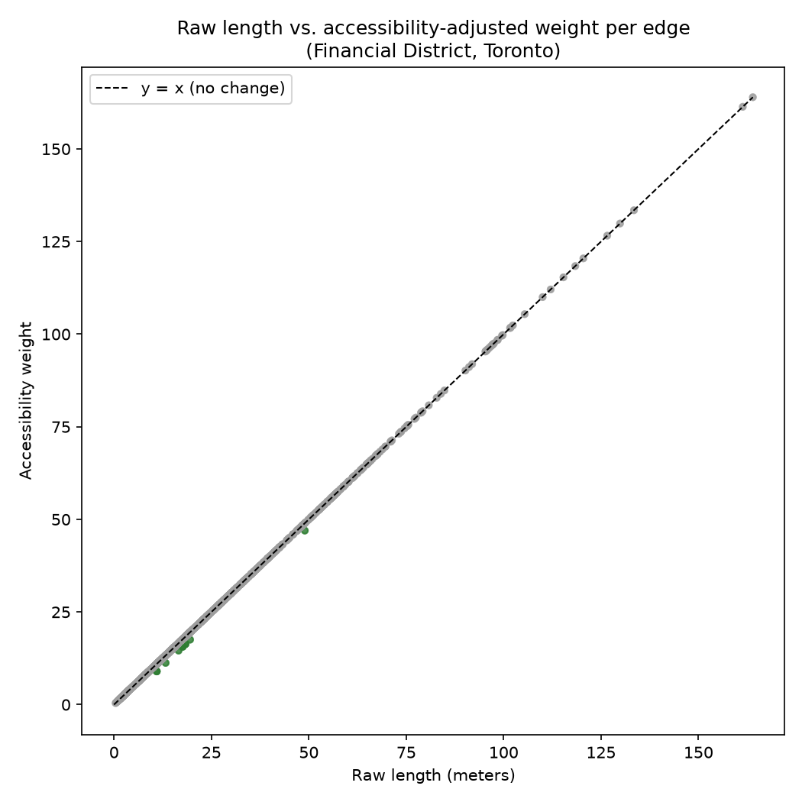

# 02 — Designing the accessibility weighting function

## The problem this solves

A plain shortest-path search only cares about `length`. But AccessPath's whole point is that the "best" route isn't always the physically shortest one — a route with a curb ramp and a smooth surface can be better than a slightly shorter one with no ramp at all. I needed a function that takes an edge's real OSM attributes and turns them into a single number the routing algorithm can actually use as a cost.

## The design

```python
def accessibility_weight(attrs):
    base = attrs.get("length", 1)
    penalty = 0

    if attrs.get("wheelchair") == "no":
        penalty += 1000
    elif attrs.get("wheelchair") in ("yes", "designated"):
        penalty -= 2

    if attrs.get("surface") in ("gravel", "dirt", "grass", "ground"):
        penalty += 10

    return base + penalty
```

The logic, in plain terms:
- **No accessibility tag at all** → return the raw `length`, unchanged. Untagged doesn't mean inaccessible — it means unknown, so it shouldn't be punished.
- **`wheelchair: no`** → a huge penalty (1000), heavy enough that Dijkstra/A* will only ever pick this edge if there's genuinely no other way through.
- **`wheelchair: yes` / `designated`** → a small discount, so the algorithm mildly prefers a confirmed-accessible path over an unknown one, all else being similar.
- **Rough `surface` (gravel/dirt/grass/ground)** → a small penalty, independent of the wheelchair tag, since surface roughness is its own real barrier.

## Testing it

First on toy dictionaries, to check the arithmetic in isolation:
- `{"wheelchair": "no"}` → 1001 (default length 1 + penalty 1000)
- `{"surface": "gravel"}` → 11 (default length 1 + penalty 10)

Then on real edges from Financial District, Toronto. The first five edges iterated came back unchanged (weight == raw length) — not a bug, just the reality that most edges in this area have ordinary paved surfaces and no wheelchair tag at all, so neither condition fires. To actually confirm the discount works, I found a real edge tagged `wheelchair: designated`:

```
18.285034254006842 -> 16.285034254006842
```

18.285 − 2 = 16.285 — exactly right.

## Visualizing it across the whole area



Every edge in Financial District, Toronto, plotted as raw `length` (x-axis) against `accessibility_weight` (y-axis), with a dashed `y = x` line for reference. Most points sit exactly on the line — the untagged majority, correctly left alone. The green points (`wheelchair: yes`/`designated`) sit slightly *below* the line, showing the small discount being applied. No red points (`wheelchair: no`) appear at all in this particular test area — consistent with what the earlier exploration found: this dataset has `yes`/`designated` tags but no `no` tags here.

**Next:** apply this weight as a real attribute on the graph itself (not just a function called on demand), then run Dijkstra/A* using that weight instead of raw `length` to get an actual accessibility-aware route.
