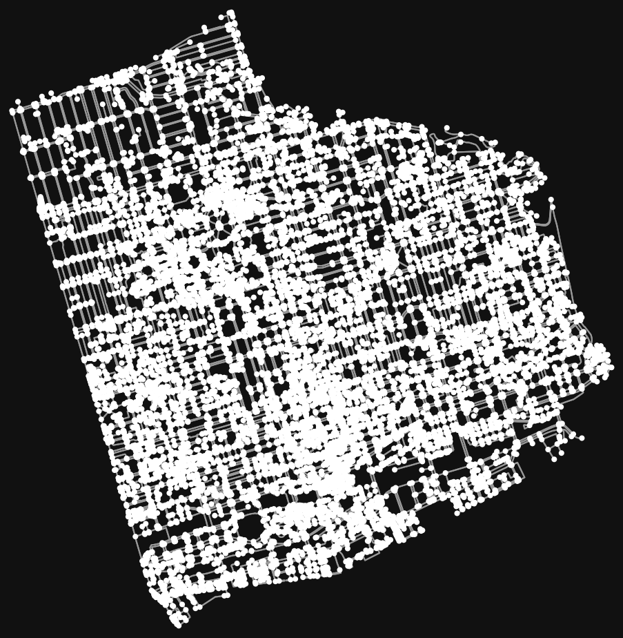

# 04 — Dataset coverage at a bigger scale, and real-world proof

## Why I needed a bigger area

Financial District (834 nodes, 2372 edges) proved the data and the arithmetic were both real — but it had zero `wheelchair: no` edges, so I could only prove the routing *decision* logic with a synthetic graph, not real OSM data. Before going further, I wanted to know: does coverage actually improve with a bigger, more varied area, and does a real `wheelchair: no` case exist anywhere nearby?

## Downtown Toronto: the real numbers

```python
G_big = ox.graph_from_place("Downtown Toronto, Toronto, Ontario, Canada", network_type="walk")
```

- **39,170 total edges** (about 16x Financial District)
- **178 edges** with a `wheelchair` tag at all
- **16 edges** with `wheelchair: no` specifically — the case Financial District didn't have
- **25,518 edges** with a `surface` tag — strong, consistent coverage



## Proving the routing decision on real data

With real `wheelchair: no` edges available, I re-ran the same `length` vs `acc_weight` comparison from notebook 03 — but this time on actual OSM data instead of a hand-built graph:

```python
no_access_edges = find_edges_with_tag(G_big, "wheelchair", "no")
u_bad, v_bad, k_bad = no_access_edges[0]

source, target = u_bad, v_bad
path_by_length = nx.shortest_path(G_big, source=source, target=target, weight="length")
path_by_acc = nx.shortest_path(G_big, source=source, target=target, weight="acc_weight")
```

```
shortest by length:     [400707035, 516949102]
shortest by acc_weight: [400707035, 3590076075, 3590076072, 6412492716, 516949102]
same route? False
```

Even with `source`/`target` set to the exact two endpoints of the inaccessible edge (so the "obvious" route is just that one direct edge), the accessibility-weighted search found and chose a real alternative path through three extra nodes instead — a genuine detour around a real `wheelchair: no` edge, found entirely from real-world OpenStreetMap data. This is stronger proof than the synthetic test in notes/03: it shows the whole pipeline (tag fix → weighting → routing) works correctly end to end on data I didn't construct myself.

## Takeaway

- Coverage scales with area size, as expected — a bigger, denser downtown region surfaced the `wheelchair: no` case Financial District didn't have.
- `surface` coverage is consistently strong (65%+ of edges here); `wheelchair` coverage is real but sparse (under 0.5%) — worth keeping in mind for how the final system should treat untagged edges (as unknown, not as implicitly accessible or inaccessible).
- The synthetic test (notes/03) and this real-data test now agree: the weighting function changes actual routing decisions, not just reported costs, in both a controlled scenario and the real world.

**Next:** with Modules 2-4 (weighting, routing, data validation) all proven, the next real step is the travel-time prediction layer from the original plan (regression baseline vs. GNN) — or deciding together whether to prioritize that now or build out the routing module into something more reusable first.
